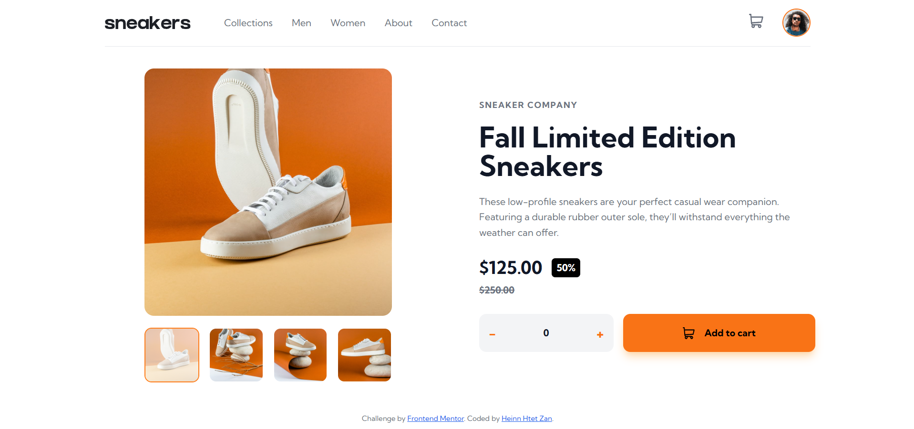
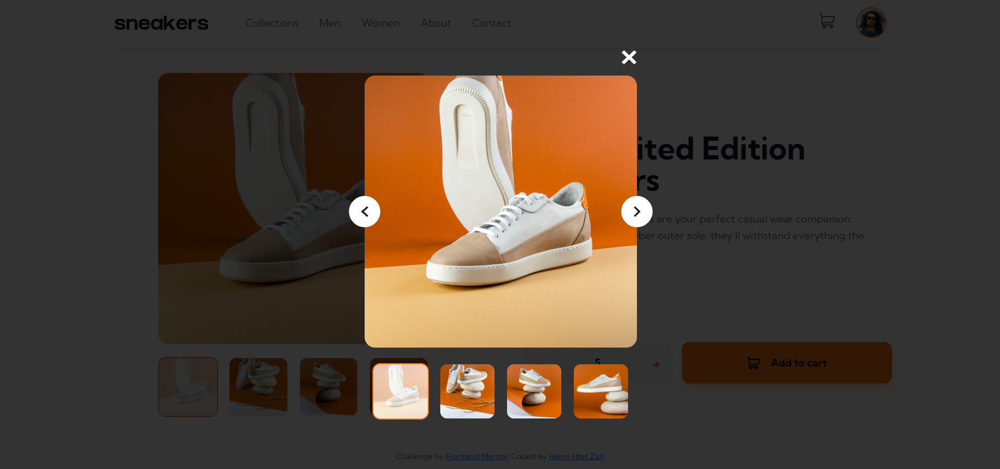
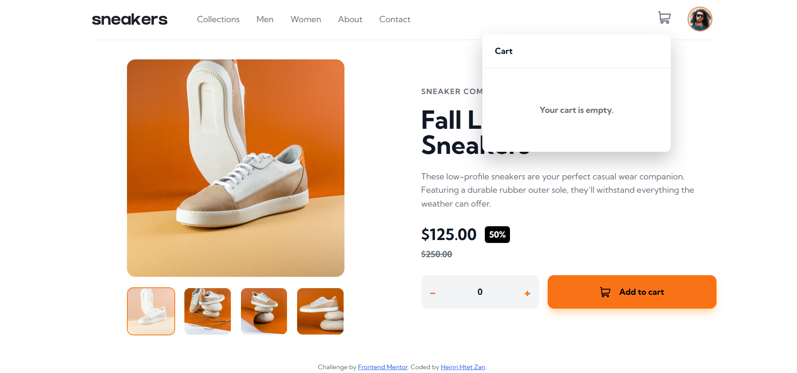
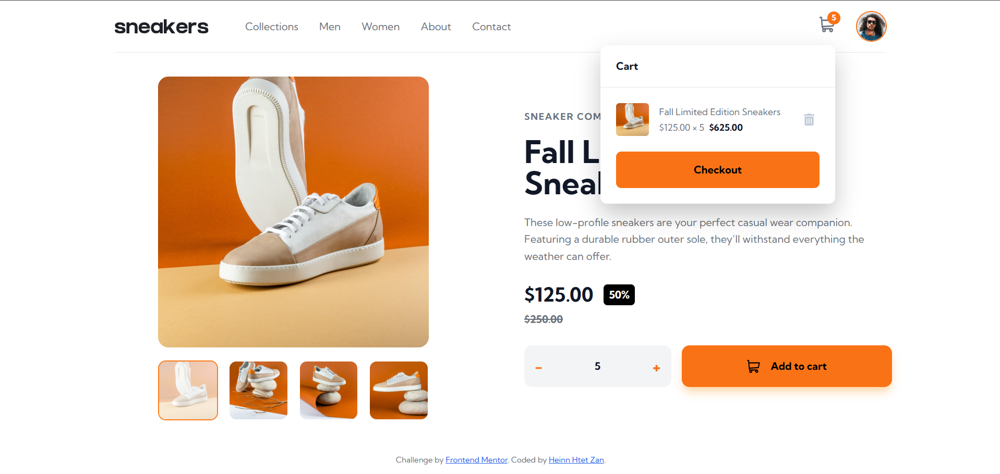
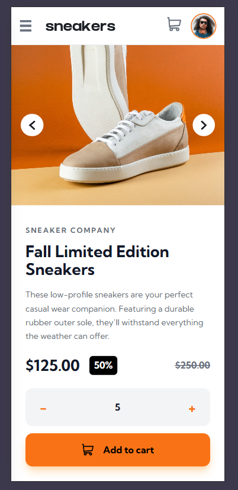
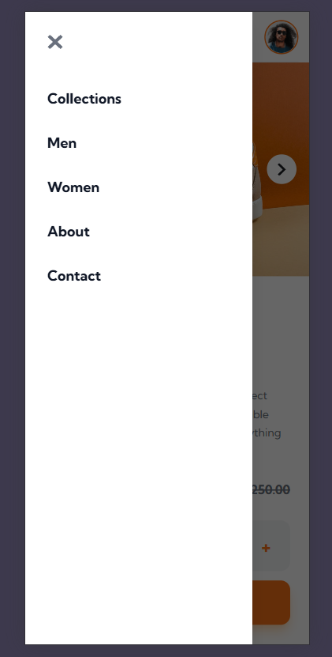
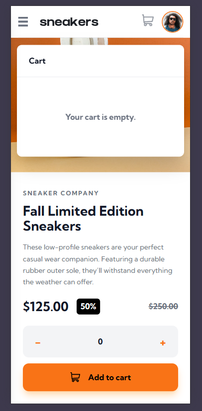
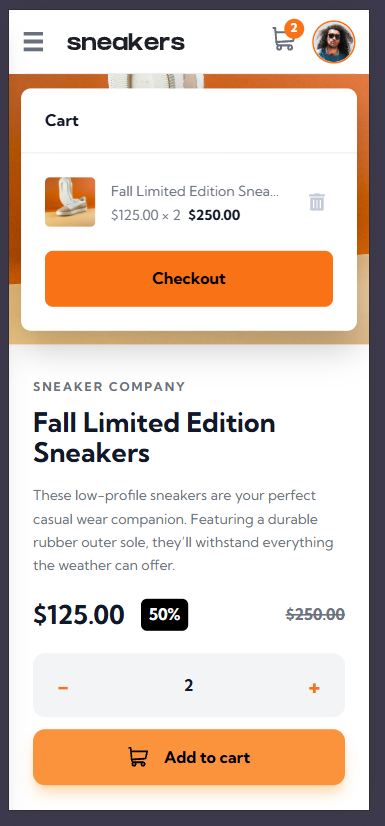

# Frontend Mentor - E-commerce Product Page

A responsive and interactive e-commerce product page built as a solution to the [Frontend Mentor E-commerce Product Page Challenge](https://www.frontendmentor.io/challenges/ecommerce-product-page-UPsZ9MJp6).

The project recreates a modern product detail page with an interactive image gallery, lightbox preview, shopping cart, quantity selector, and responsive navigation. It was built using **HTML5, Tailwind CSS, and Vanilla JavaScript**.

<p align="center">
  <a href="https://frontend-mentor-ecommerce-product-p-gamma.vercel.app/">
    <strong>🚀 View Live Demo</strong>
  </a>
  &nbsp; | &nbsp;
  <a href="https://github.com/Koheinn/frontend-mentor-ecommerce-product-page">
    <strong>📂 View Source Code</strong>
  </a>
</p>

---

## 📸 Screenshots

Here are screenshots of the application across different screen sizes and interaction states.

### Desktop

| Main Product Page | Product Image Lightbox |
|:---:|:---:|
|  |  |
| **Empty Shopping Cart** | **Shopping Cart with Product** |
|  |  |

### Mobile

| Mobile Product Page | Mobile Navigation Menu |
|:---:|:---:|
|  |  |
| **Empty Shopping Cart** | **Shopping Cart with Product** |
|  |  |

---

## ✨ Features

### 🛍️ Product Display
- Clean and modern e-commerce product layout.
- Product information, pricing, and discount display.
- Responsive design for desktop, tablet, and mobile devices.

### 🖼️ Interactive Product Gallery
- Switch between product images using thumbnail navigation.
- Active thumbnail indicators.
- Desktop lightbox preview with navigation controls.
- Mobile next and previous image navigation.
- Touch swipe support for mobile devices.

### 🛒 Shopping Cart
- Add products to the shopping cart.
- Display selected product information and quantity.
- Automatically calculate the cart total.
- Remove products from the cart.
- Update the cart item counter.
- Display an empty-cart message when no products have been added.

### 📱 Responsive Navigation
- Mobile navigation drawer.
- Desktop navigation menu.
- Interactive menu controls.
- Responsive layout adjustments for different screen sizes.

### ♿ User Experience
- Interactive hover effects and transitions.
- Keyboard navigation support.
- Accessible labels and button states.
- Smooth interactions across different screen sizes.

---

## 🛠️ Built With

| Technology | Purpose |
|---|---|
| HTML5 | Semantic page structure |
| Tailwind CSS | Utility-first styling |
| CSS3 | Custom styling, layouts, and transitions |
| Vanilla JavaScript | Interactive functionality and state management |
| Flexbox | Responsive component layouts |
| CSS Grid | Page layout |
| Vercel | Deployment and hosting |

---

## 📂 Project Structure

```text
frontend-mentor-ecommerce-product-page/
│
├── design/                 # Original challenge design references
│
├── images/                 # Product images and other visual assets
│
├── screenshots/            # Desktop and mobile screenshots
│   ├── Desktop-page.png
│   ├── Desktop-page-lightbox.png
│   ├── Desktop-page-with-empty-cart.png
│   ├── Desktop-page-with-full-cart.png
│   ├── Mobile-page.png
│   ├── Mobile-page-menu.png
│   ├── Mobile-page-with-empty-cart.png
│   └── Mobile-page-with-full-cart.png
│
├── index.html              # Main application
├── style-guide.md          # Frontend Mentor style guide
└── README.md               # Project documentation
```

---

## 🚀 Getting Started

You can run this project locally on your computer by following these steps.

### Prerequisites

- A modern web browser.
- Git installed on your computer.
- A code editor such as Visual Studio Code.

### 1. Clone the Repository

```bash
git clone https://github.com/Koheinn/frontend-mentor-ecommerce-product-page.git
```

### 2. Navigate to the Project Directory

```bash
cd frontend-mentor-ecommerce-product-page
```

### 3. Open the Project

Open the project folder in Visual Studio Code:

```bash
code .
```

Then open `index.html` in your browser.

You can also use the **Live Server** extension in Visual Studio Code for local development.

> **Note:** This project uses Tailwind CSS through its CDN, so no separate package installation or build command is required for the current setup. For a production application, a compiled Tailwind CSS build is recommended.

---

## 💡 What I Learned

Building this project helped me strengthen my frontend development skills and gain more practical experience with interactive web applications.

Some of the key things I learned include:

- Creating responsive layouts using CSS Flexbox and Grid.
- Building interactive user interfaces with Vanilla JavaScript.
- Managing application state for shopping cart functionality.
- Implementing image galleries with thumbnail navigation.
- Creating lightbox interfaces and modal interactions.
- Handling mobile navigation and responsive UI components.
- Improving user experience through animations and hover effects.
- Structuring frontend projects and organizing static assets.

---

## 🔮 Future Improvements

There are several areas I would like to explore and improve in future iterations:

- Refactor JavaScript into reusable modules.
- Further improve accessibility and keyboard interactions.
- Add more polished animations and micro-interactions.
- Integrate a backend API for product and cart management.
- Implement persistent cart data using Local Storage.
- Add checkout functionality and payment integration.
- Explore React and TypeScript for a more scalable architecture.

---

## 🤝 AI Collaboration

AI tools were used as supporting resources during development for technical guidance, debugging, problem-solving, and documentation improvements.

The project was reviewed and refined as part of the development process, with a focus on maintaining functionality, improving code quality, and enhancing the user experience.

---

## 👨‍💻 Author

**Heinn Htet Zan**

- GitHub: [@Koheinn](https://github.com/Koheinn)
- Frontend Mentor: [@Koheinn](https://www.frontendmentor.io/profile/Koheinn)
- LinkedIn: [Heinn Htet Zan](https://www.linkedin.com/in/heinn-htet-zan-040794291/)

---

## 🙏 Acknowledgments

- [Frontend Mentor](https://www.frontendmentor.io/) for providing the challenge and design resources.
- The Frontend Mentor community for inspiration, feedback, and learning resources.

---

<p align="center">
  ⭐ If you find this project interesting, feel free to explore the repository!
</p>

<p align="center">
  <strong>Built with ❤️ by Heinn Htet Zan</strong>
</p>